# ZeroHourReloaded

**ZeroHourReloaded** is a modernized, native **64-bit (`x64`)**, **Vulkan 1.3**, **SDL3**, **FFmpeg 8.1**, **Rust-augmented** engine for *Generals: Zero Hour*, forked from [`TheSuperHackers/GeneralsGameCode`](https://github.com/TheSuperHackers/GeneralsGameCode).

It retains the battle-tested C++20 simulation, INI/BIG/W3D/map loaders, AI, scripts, and replay compatibility while replacing every legacy 32-bit Windows-only engine dependency (`d3d8.dll`, `mss32.dll`, `binkw32.dll`, `dinput8.dll`, and Win32 windowing) with modern open-source 64-bit subsystems and a live-toggleable Vulkan 1.3 visual remaster.

> **Legal Notice:** Zero copyrighted game files, `.big` archives, or third-party AI weights are stored in this repository. You must own a legal copy of *Command & Conquer: Generals – Zero Hour* (e.g., via *The Ultimate Collection* on [Steam](https://store.steampowered.com/bundle/39394)). ZeroHourReloaded automatically locates your local installation on launch.

---

## Live 50/50 Split-Screen Overview (`F9`)

Classic 2003 DirectX 8 look on the **left** vs. ZeroHourReloaded's native 64-bit Vulkan 1.3 remaster on the **right** — toggled instantaneously in-game with **`F9`** (captured live at `1280×720` on AMD Radeon RX 9070 XT with Khronos Vulkan validation enabled and `0` validation errors):

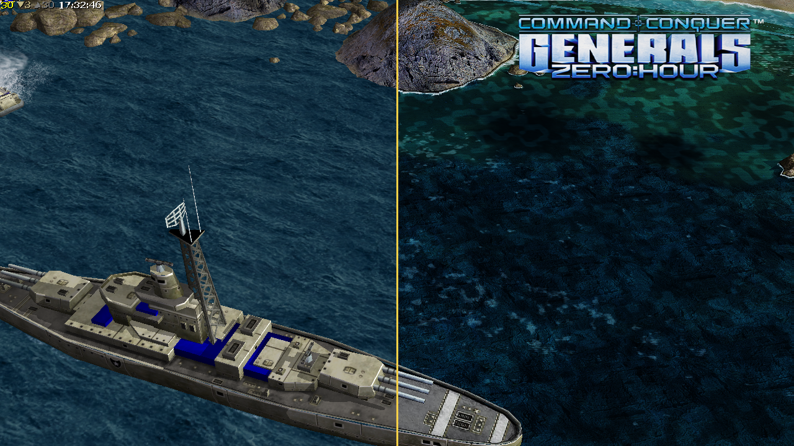

---

## Feature-by-Feature A/B Showcase

### 1. Full-Frame Vulkan 1.3 Remaster (`F9`)
Replaces legacy 32-bit DirectX 8 (`d3d8.dll`) with a native 64-bit Vulkan 1.3 dynamic-rendering pipeline (`rust/zhr-vulkan`: `ash` + `gpu-allocator` + `naga` WGSL→SPIR-V) featuring 16× anisotropic filtering, full mipmaps, HDR bloom, ACES filmic tonemapping, and AMD FidelityFX CAS sharpening.

| Classic (2003 Baseline) | ZeroHourReloaded (Vulkan 1.3 Remastered) |
| :---: | :---: |
| 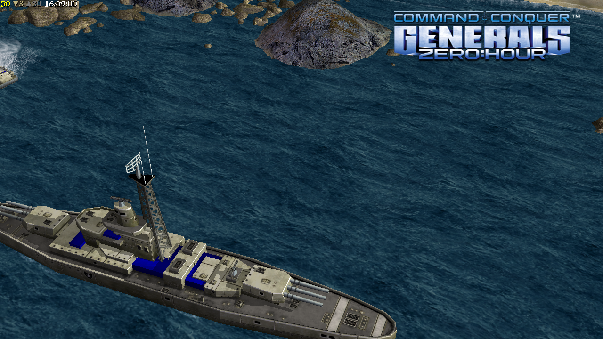 | 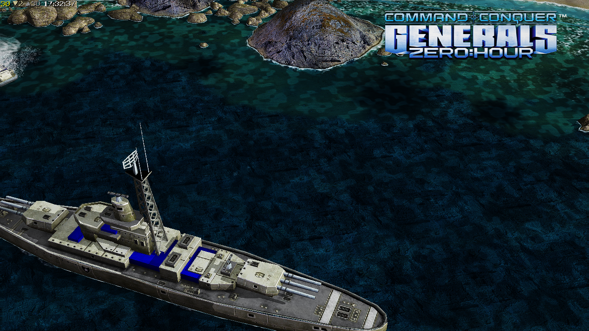 |
| *Flat 2003 Gouraud shading, low-res textures, static water, unsmoothed silhouettes (`171,573` tris, `0` remastered textures)* | *PBR GGX + Sky IBL, animated water, volumetric shadows, bilateral SSAO, HDR bloom/ACES/CAS, smoothed `.W3D` meshes & 2× textures (`182,868` tris, `30` remastered textures)* |

---

### 2. Depth-Aware Modern Coastal & Oceanic Water, Screen-Space Refraction & PBR Terrain Relief (`F10`)
Replaces flat dark scrolling water planes and hard dry polygon rock intersections with a pre-water HDR + linearized depth snapshot (`PostProcessPipeline::capture_water_depth`) driving true per-pixel optical water:
- **Screen-Space Underwater Refraction & Beer-Lambert Absorption:** Translucent emerald-turquoise coastal shallows revealing submerged seabed and rocks, smoothly absorbing into cerulean and deep oceanic sapphire with depth-guarded dry-rock rejection.
- **Organic Coastal Shoreline Foam & Wet Feathering:** Animated lacy white contact foam hugging rocks, islands, and ship hulls, rolling beach surf bands, soft wet shoreline edge transitions, dappled shallow sun caustics, and backlit wave-crest subsurface scattering (SSS).
- **Fluid Multi-Directional Swells, Sky/Cloud Fresnel Reflections & HDR Sun Glints:** Smooth rolling waves with atmospheric sky/cloud Fresnel reflections, dual-lobe GGX specular glints, and PBR micro-normal stone relief on coastlines.

| Classic Water & Coastline | Remastered Modern Coastal Water & PBR Rocks |
| :---: | :---: |
| 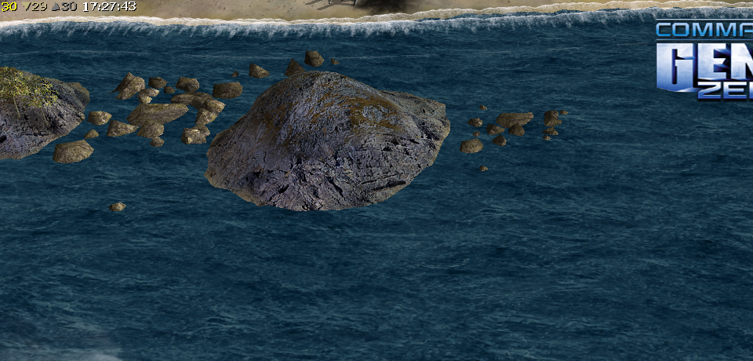 | 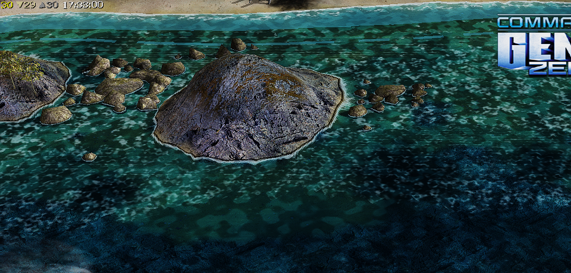 |
| *Flat dark water with hard dry polygon cuts around rocks & islands and no shoreline blending* | *Translucent turquoise shallows with seabed refraction, lacy rock/island shoreline foam, dappled caustics, liquid swells & PBR stone relief* |

---

### 3. Crease-Preserving `.W3D` Mesh Smoothing (`F7`), Volumetric Shadows, Bilateral SSAO & 2× Texture Remastering (`F8`)
- **Rig-Safe Phong Mesh Subdivision (`F7`):** Smooths curved silhouettes (turrets, radar domes, hulls, barrels, wheels) while preserving sharp armor creases and 100% of `.W3D` bone hierarchies and animations.
- **Hardware Stencil Volumetric Shadows & Occluded Silhouettes:** Full `VkStencilOpState` shadow volume extrusion and occluded unit highlighting.
- **Pre-UI Bilateral Depth SSAO (`F10`):** Half-resolution edge-preserving ambient occlusion grounding units, deck structures, and terrain crevices without bleeding onto the 2D HUD.
- **Zero-Stall Async 2× Texture Remastering (`F8`):** `rust/zhr-remaster` upscales diffuse textures asynchronously on background workers with alpha/house-color isolation and persistent BLAKE3 disk caching (`%LOCALAPPDATA%/ZeroHourReloaded/cache/`), hot-swapping Vulkan descriptors with zero frame hitches.

| Classic Hull, Turrets & Lighting | Remastered Mesh, PBR/SSAO, Shadows & 2× Textures |
| :---: | :---: |
| 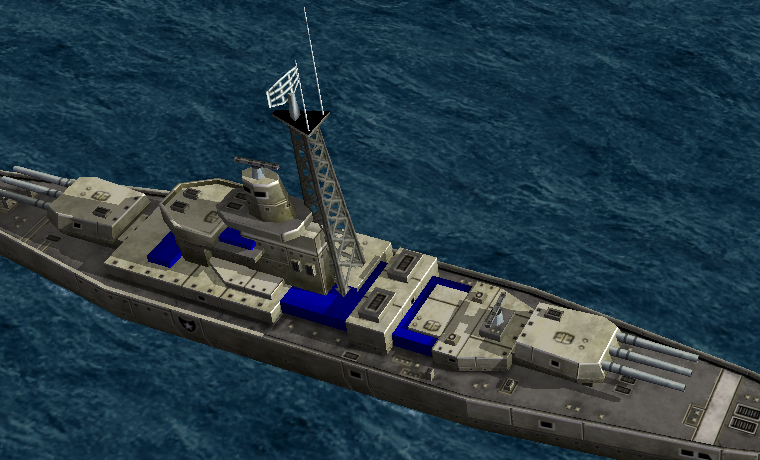 | 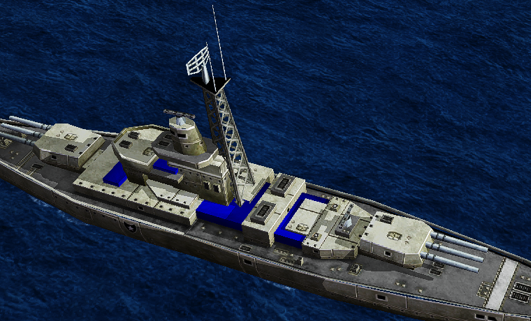 |
| *Faceted 2003 geometry, muddy DXT1 textures, flat lighting with no crevice occlusion* | *Smoothed curved geometry, metallic GGX + Sky IBL specular, crisp volumetric shadows, bilateral SSAO, and 2× remastered textures* |

---

### 4. Native 64-bit FFmpeg 8.1 Cutscene Video & Synced Rust Audio (`zhr-audio`)
Legacy 32-bit `binkw32.dll` and `mss32.dll` cannot load in a 64-bit process. ZeroHourReloaded replaces both:
- **Video (`FFmpegVideoPlayer` + `FFmpegFile`):** Automatically fetches and links official LGPL **FFmpeg 8.1** (`avcodec-62`, `avformat-62`, `avutil-60`, `swscale-9`, `swresample-6`) to decode `.bik` intro movies, shell backgrounds, and campaign cutscenes directly from `.big` archives via custom seekable AVIO callbacks.
- **Audio (`rust/zhr-audio`):** Native 64-bit audio engine (`cpal` + `symphonia` replacing `mss32.dll`) handling music, speech, 2D UI SFX, 3D positional battlefield audio, and a lock-free `VideoAudioQueue` PCM ring buffer that mixes synchronized FFmpeg cutscene audio cleanly in real time.

| Legacy 64-bit Baseline (No `binkw32.dll`) | ZeroHourReloaded (FFmpeg 8.1 LGPL + `zhr-audio`) |
| :---: | :---: |
| *Intro & campaign `.bik` movies skipped/black on 64-bit because 32-bit `binkw32.dll` cannot be loaded.* | 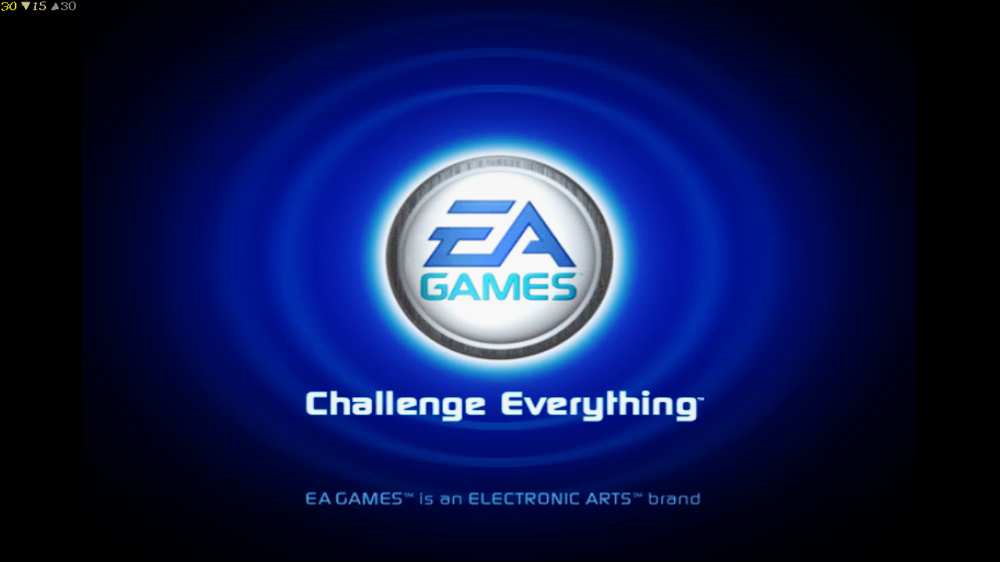 |
| | *Full-resolution `1280×720` `.bik` playback on SDL3 + Vulkan 1.3 with synchronized `zhr-audio` PCM mixing and `0` validation errors* |

---

### 5. Modern Frosted-Glass Main Menu, Tabbed Options Menu & 8-Bit HD Typography (`F9`)
Replaces the stretched 2003 full-screen blue grid border, blurry bitmap button frames, cramped single-page Options dialog, and 4-bit quantized (`A4R4G4B4`) fonts with a crisp, resolution-independent tactical UI — **live-toggleable via `F9`** and scaling cleanly from `1280×720` to `3840×2160` (4K):
- **Real-Time Vulkan 1.3 Frosted Glass:** Quarter-resolution separable Gaussian blur of the live 3D shell battle (or 2D `-quickstart` backdrop) sampled directly behind menu panels (`PostProcessPipeline::capture_ui_backdrop` + `WW3D2_UBER_WGSL`).
- **Reworked 4-Tabbed Settings Menu (`GRAPHICS`, `AUDIO`, `CONTROLS`, `NETWORK`) & Unlocked High-FPS Rendering:** Unlocks render framerate from the 2003 30 FPS cap (defaulting to **144 FPS** over tear-free Vulkan `MAILBOX` presentation while preserving authentic **30 Hz** decoupled simulation logic for replay & multiplayer compatibility), and exposes **Max Render FPS (`30 / 60 / 120 / 144 / 240 / Uncapped`)** plus all ZeroHourReloaded Vulkan 1.3 Remaster settings (**Visual Mode**, **PBR/Coastal Water/SSAO**, **HDR Bloom/ACES/CAS**, **2× Remastered 3D Textures**, **Phong `.W3D` Mesh Smoothing**) directly inside the `GRAPHICS` tab with live immediate preview, `Cancel` revert, `Defaults` restore, and automatic `Options.ini` persistence, alongside modern vector checkboxes, cyan gradient sliders, sleek dropdown chevrons, and crisp header version badges.
- **Full 8-Bit Antialiased HD Fonts (`render2dsentence.cpp`, `render2d.cpp`):** Upgraded glyph atlases from 4-bit `A4R4G4B4` (16 alpha levels) to full 8-bit `A8R8G8B8` (256 alpha levels) using crisp military `Franklin Gothic Medium` typography, disabled the legacy D3D8 `-0.5` pixel UV bias on Vulkan so point-sampled glyphs land dead-center on texels with zero jagged distortion, and excluded 2D UI/font atlases from 2× texture upscaling — preserving 100% of original hitboxes, transitions, sub-menus, and in-game HUD cameos.

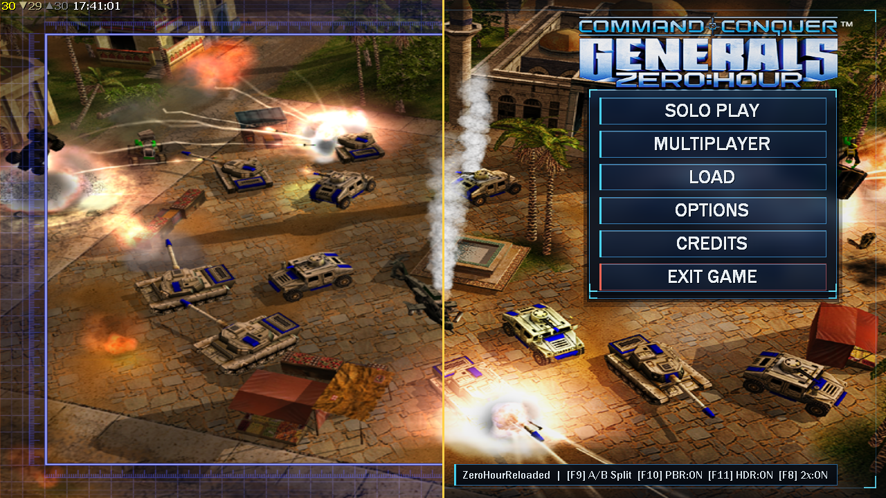

| Classic 2003 Main Menu | ZeroHourReloaded Modern Main Menu |
| :---: | :---: |
| 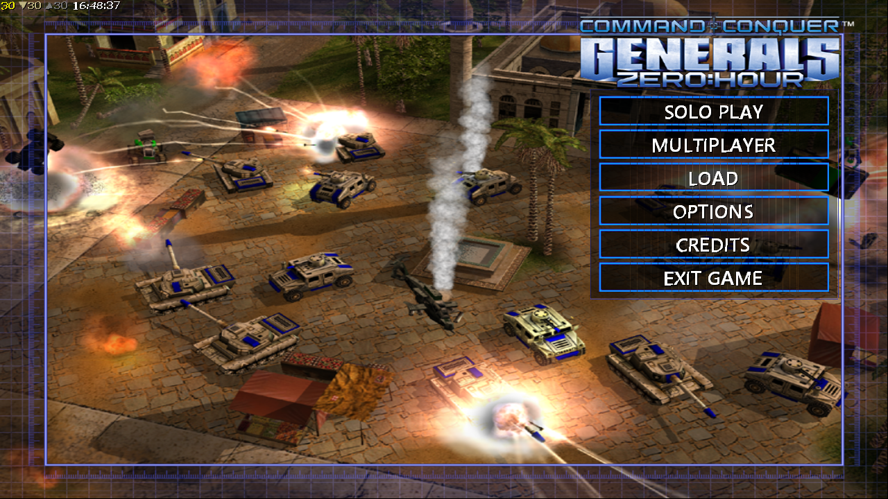 | 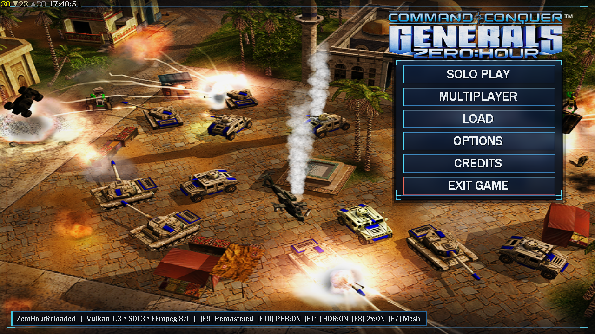 |
| 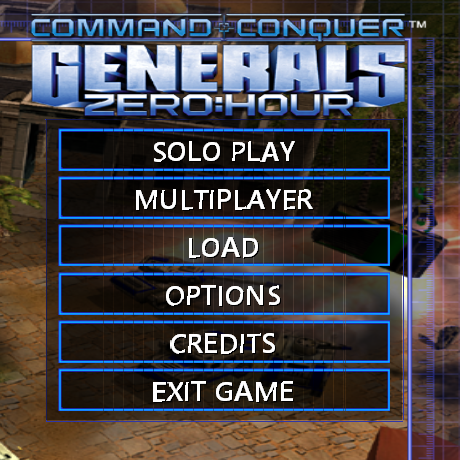 | 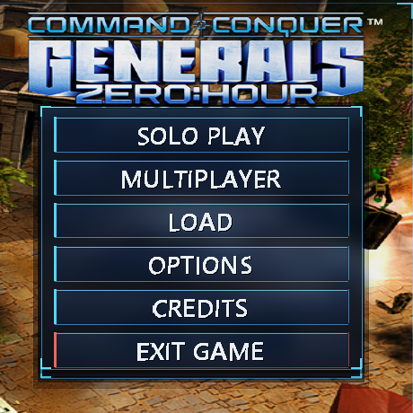 |
| *Stretched blue grid ruler, blurry bitmap outlines, flat opaque boxes* | *Clean widescreen framing, real-time Vulkan frosted glass, tactical accent rails, 8-bit antialiased HD typography, live status pill* |

| Classic 2003 Controls Skin (Tabbed Layout) | ZeroHourReloaded Modern Frosted-Glass Options Menu |
| :---: | :---: |
| 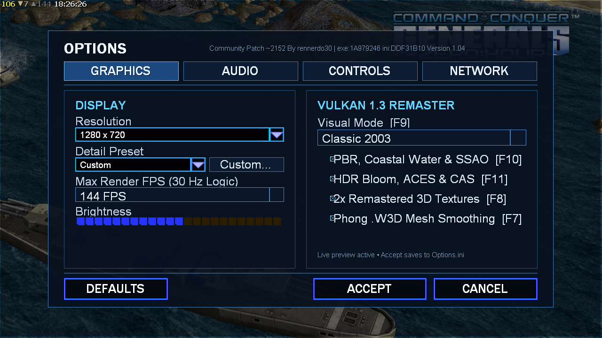 | 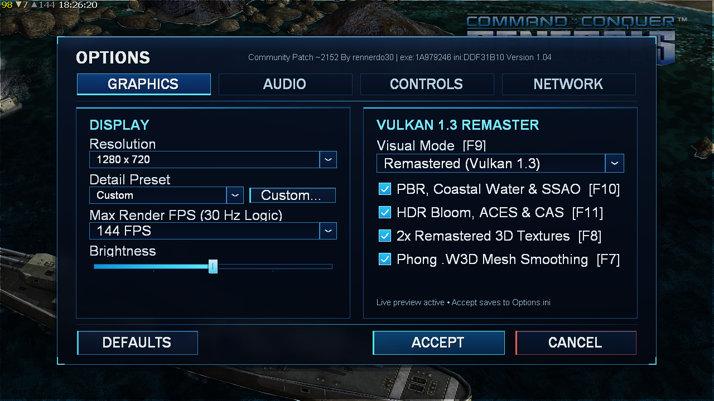 |
| *Legacy 2003 segmented sliders & bitmap dropdowns* | *Frosted-glass modal over live 3D shell battle, 4-tab bar, modern vector gadgets & persistent Vulkan 1.3 Remaster controls* |

---

### 6. Native Cross-Platform SDL3 Window & Input (`rust/zhr-platform`)
Replaces legacy Win32 `CreateWindow`/`WndProc` boilerplate and `DirectInput8` (`dinput8.dll`) with **SDL3 3.4.20** (`Core/GameEngineDevice/Source/SDLDevice/`) backed by a Rust USB HID `SDL_Scancode` → Zero Hour `KeyDefType` mapping crate (`rust/zhr-platform`):
- Resizable Vulkan-ready SDL3 window with automatic swapchain sizing (`-xres`/`-yres` respected immediately).
- Full RTS keyboard & hotkey support (control groups, camera controls, modifiers, `F7`–`F11` remaster toggles) with zero `DirectInput8` dependency.
- Preserves custom W3D faction cursors and mouse behavior across menus and skirmish gameplay.
- Cross-platform Vulkan surface FFI hooks (`zhr_vk_init_win32`, `zhr_vk_init_xlib`, `zhr_vk_init_wayland`, `zhr_vk_init_macos`) prepared for Linux and macOS targets.

---

## Architecture Status

| Legacy 32-bit Blocker | ZeroHourReloaded 64-bit Replacement | Status |
|---|---|---|
| DirectX 8 (`d3d8.dll`) | `rust/zhr-vulkan` (`ash` Vulkan 1.3 + `gpu-allocator` + `naga` WGSL) + `VulkanDX8Bridge.cpp` | **Working** |
| Miles Sound System (`mss32.dll`) | `rust/zhr-audio` (`cpal` + `symphonia` 2D/3D mixer + video PCM stream) via `MilesLoader.cpp` | **Working** |
| Bink Video (`binkw32.dll`) | `FFmpegVideoPlayer` + `FFmpegFile` (FFmpeg 8.1 LGPL) + `zhr-audio` `VideoAudioQueue` | **Working** |
| Win32 Window + `DirectInput8` | SDL3 3.4.20 (`SDL3Platform` + `SDL3Keyboard`) + `rust/zhr-platform` | **Working** |
| 2003 Low-Res Visuals | PBR/GGX/IBL, Animated Water, Volumetric Stencil Shadows, Bilateral SSAO, HDR Bloom/ACES/CAS, Phong `.W3D` Smoothing (`F7`), Async 2× `zhr-remaster` (`F8`) | **Working** |
| 2003 Stretched Menu UI & 4-bit Fonts | Real-time Vulkan frosted-glass backdrop (`PostProcessPipeline`), `ZhrMenuStyle` tactical panels/buttons, full 8-bit `A8R8G8B8` HD typography (`F9` toggleable) | **Working** |

See [docs/ARCHITECTURE.md](docs/ARCHITECTURE.md) for deeper technical details on the hybrid C++20/Rust FFI architecture and local asset remastering pipeline.

---

## Live In-Game Hotkeys

Toggle every visual remaster subsystem live during the shell map or skirmish without restarting:

| Hotkey | Feature | Modes / Behavior |
| :---: | :--- | :--- |
| **`F9`** | **Master Graphics Mode** | Cycles **Remastered** → **50/50 Split-Screen A/B** → **Classic 2003** |
| **`F10`** | **PBR, Water & SSAO** | Toggles GGX/IBL lighting, animated water & reflections, terrain PBR relief, and bilateral SSAO |
| **`F11`** | **HDR Post-Processing** | Toggles HDR Bloom, ACES Filmic Tonemapping, and AMD CAS sharpening |
| **`F7`** | **Mesh Smoothing** | Toggles crease-preserving Phong `.W3D` geometry subdivision |
| **`F8`** | **2× Remastered Textures** | Toggles zero-stall async 2× upscaled textures (with persistent BLAKE3 disk cache) |

---

## Quick Start (Windows 64-bit)

### Prerequisites
- **Visual Studio 2022** (C++20 desktop workload) + **CMake** + **Ninja**
- **Rust toolchain** (`rustup`, stable MSVC `x86_64-pc-windows-msvc`)
- **Vulkan SDK** (or up-to-date GPU driver with Vulkan 1.3 support)
- A legal local installation of *Command & Conquer: Generals – Zero Hour* (`INIZH.big`)

*(SDL3 3.4.20 and LGPL FFmpeg 8.1 SDKs are downloaded and staged automatically by CMake on first configure.)*

### 1. One-Time Fast Build Setup (Optional `sccache` + `rust-lld`)
```powershell
pwsh -File scripts/setup-rust.ps1
```

### 2. Build & Launch in One Step
```powershell
# Double-click play.bat in the repo root, OR run:
cargo run

# Or invoke the PowerShell launcher directly:
pwsh -File scripts/run-win64-vulkan.ps1
pwsh -File scripts/run-win64-vulkan.ps1 -NoShellMap -Validation
pwsh -File scripts/run-win64-vulkan.ps1 -AssetsDir "C:\Path\To\Zero Hour"
```

The launcher incrementally compiles Rust + C++20, stages `generalszh-vulkan64.exe` alongside `SDL3.dll` and the FFmpeg LGPL DLLs in your Zero Hour directory (leaving any original 32-bit `generalszh.exe` untouched), and launches straight into native 64-bit Vulkan 1.3.

### 3. Build Only / Run Tests
```powershell
# Full 64-bit Vulkan + SDL3 + FFmpeg build
pwsh -File scripts/build-win64-vulkan.ps1 -Config RelWithDebInfo -Target z_generals

# Rust workspace tests & lints
cargo test --workspace
cargo clippy --workspace --all-targets -- -D warnings
```

### Useful Environment Variables
| Variable | Values / Example | Purpose |
|---|---|---|
| `ZHR_ASSETS_DIR` | `C:\Games\Zero Hour` | Override auto-discovered Zero Hour asset folder |
| `ZHR_GRAPHICS_MODE` | `remastered` \| `split` \| `classic` | Starting visual mode (can still cycle live with `F9`) |
| `ZHR_VK_VALIDATION` | `1` \| `0` | Enable Khronos Vulkan validation layers |
| `ZHR_REMASTER_OFF` | `1` | Disable background 2× texture remastering at startup |

---

## Licensing & Attribution

- **License:** [GPL-3.0-or-later](https://www.gnu.org/licenses/gpl-3.0.html) with EA GPL Section 7 Additional Terms — see [LICENSE.md](LICENSE.md).
- **Upstream:** Built on [`TheSuperHackers/GeneralsGameCode`](https://github.com/TheSuperHackers/GeneralsGameCode).
- **Third-Party Libraries:** SDL3 (zlib license), FFmpeg 8.1 (LGPL-2.1-or-later shared build), `ash`, `gpu-allocator`, `naga`, `cpal`, `symphonia`, `blake3`.
- **Disclaimer:** EA has not endorsed and does not support this project. All trademarks are the property of their respective owners.
